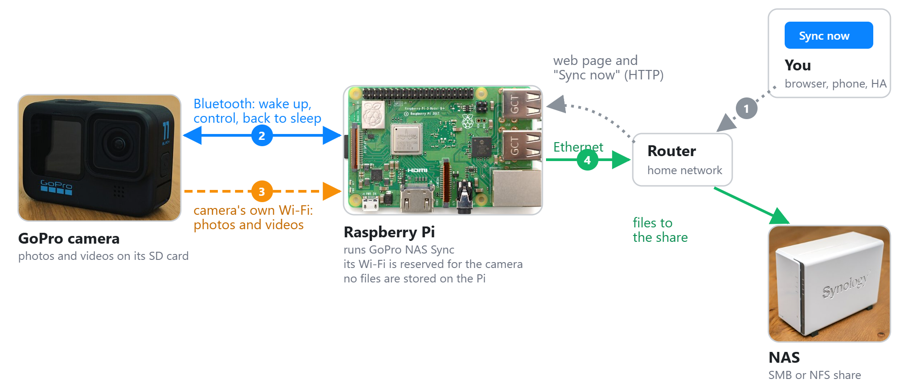
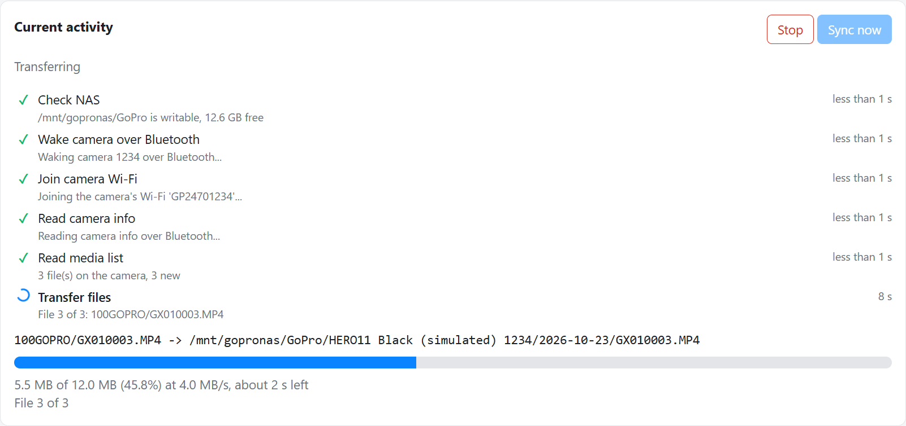

# gopro-nas-sync

Copy the photos and videos from your GoPro to your NAS automatically, without a phone, a cable or a computer.

A Raspberry Pi sits next to where you put the camera down. When you start a sync (a button on its web page, a
Home Assistant automation, a phone shortcut or a plain `curl`), the Pi wakes the camera over Bluetooth, joins the
camera's own Wi-Fi, and streams every file it hasn't copied yet straight to the NAS over Ethernet. Then it puts
the camera back to sleep. Nothing is buffered on the Pi's SD card, and the camera keeps its files.



1. You start a sync from the web page or through the HTTP API.
2. The Pi wakes the camera over Bluetooth and asks it to turn on its Wi-Fi.
3. The Pi joins the camera's Wi-Fi and downloads the new files.
4. The files go straight through the Pi's Ethernet port to a share on your NAS.



Features:

- Remembers which files were already copied, so each sync only copies new ones. You can reset single entries or
  the whole list to copy files again.
- Interrupted downloads resume where they stopped. Stopping a sync keeps the files already copied.
- Pairs cameras from the web page and mounts SMB or NFS shares itself.
- Step-by-step progress on the web page, plus a built-in manual with the camera menu paths and troubleshooting.
- A small HTTP API for automations, optionally protected by a token.

Built on the official [Open GoPro Python SDK](https://gopro.github.io/OpenGoPro/python_sdk/).

### Supported cameras

Every camera that speaks Open GoPro API 2.0:

- HERO9 Black (firmware 1.60 or later)
- HERO10 Black
- HERO11 Black and HERO11 Black Mini
- HERO12 Black
- HERO13 Black
- newer models as the SDK adds them

You can pair several cameras. A sync processes them one after another. Older models (HERO8 and earlier, MAX) use a
different, undocumented protocol and are not supported.

Tested with a HERO11 Black on a Raspberry Pi 3 Model B running Raspberry Pi OS Trixie (64-bit), copying to a
Synology NAS at about 5.5 MB/s (roughly 20 GB per hour).

## Deploying

### What you need

- **A Raspberry Pi with built-in Wi-Fi and Bluetooth**: Pi 3 Model B or B+, Pi 4, Pi 5, or Zero 2 W with a USB
  Ethernet adapter.
- **Raspberry Pi OS Bookworm (2023) or newer**, Lite or Desktop; 64-bit is recommended. The app controls Wi-Fi
  through **NetworkManager**, which became the default in Bookworm. Older releases (Bullseye and before) use
  `dhcpcd` instead and are refused by the installer: flash a current image instead of upgrading.
- **An Ethernet cable** from the Pi to your router. The Pi's Wi-Fi chip is used only for the camera, so the Pi must
  not use Wi-Fi for your home network.
- **A NAS with an SMB or NFS share** on the same network, and a user with write permission. Any directory you mount
  on the Pi yourself works too.
- **A supported GoPro.** On a Pi 3 or Zero 2 W the camera's Wi-Fi band must be set to 2.4 GHz, because those Pis
  can't use 5 GHz.

### Install

1. Flash **Raspberry Pi OS Lite (64-bit)** to the SD card with [Raspberry Pi Imager](https://www.raspberrypi.com/software/).
   In the customisation settings, set a hostname (for example `gopro-sync`), a user name and password, and enable
   SSH. Leave the Wi-Fi network empty.
2. Put the card in the Pi, connect the Ethernet cable and power it on.
3. From your computer, log in and run the installer:

   ```bash
   ssh <user>@gopro-sync.local          # or use the Pi's IP address from your router

   # Optional: set your Wi-Fi country (needed to see a camera on 5 GHz with a Pi 3 B+, 4 or 5)
   sudo raspi-config nonint do_wifi_country DE

   curl -fsSL https://raw.githubusercontent.com/kitschen/gopro-nas-sync/main/install.sh | sudo bash
   ```

   The installer asks for the web port (default 8080), whether to protect the API with a token, and optionally
   the NAS settings. Press Enter to accept the defaults; everything can be changed later in the web page. At the
   end it prints the address of the web page.

4. Open `http://gopro-sync.local:8080/` in a browser. A welcome window explains the setup, and the **Manual** tab
   has the full step-by-step guide. In short:
   1. **NAS** tab: enter the share, click *Test connection*, then *Save and mount*.
   2. On the camera: turn on *Preferences > Wireless Connections*, set the Wi-Fi band if needed, and open
      *Connect Device > GoPro Quik App*.
   3. **Cameras** tab: click *Pair camera*.
   4. **Status** tab: click *Sync now*.

What the installer does:

- installs `bluez`, `network-manager`, `cifs-utils`, `nfs-common`, and [uv](https://docs.astral.sh/uv/) with a
  dedicated Python environment in `/opt/gopro-sync`
- creates the system user `gopro-sync`, which may use Bluetooth and manage NetworkManager through a polkit rule
- installs a small root helper for mounting the NAS; sudoers lets the service run only that helper
- starts `gopro-sync.service` and enables it at boot

Settings live in `/etc/gopro-sync/config.toml` and the list of copied files in `/var/lib/gopro-sync`.

### Update and uninstall

```bash
# Update to the latest version (settings and history are kept)
curl -fsSL https://raw.githubusercontent.com/kitschen/gopro-nas-sync/main/install.sh | sudo bash

# Run the setup questions again
curl -fsSL https://raw.githubusercontent.com/kitschen/gopro-nas-sync/main/install.sh | sudo bash -s -- --reconfigure

# Remove the app; add --purge to also delete settings, history and the service user
curl -fsSL https://raw.githubusercontent.com/kitschen/gopro-nas-sync/main/install.sh | sudo bash -s -- --uninstall
```

The files on your NAS are never touched. From a checkout, the same works with `sudo ./install.sh [option]`.

### Starting a sync automatically

```bash
curl -X POST http://gopro-sync.local:8080/api/sync
# with a token:
curl -X POST -H "Authorization: Bearer <token>" http://gopro-sync.local:8080/api/sync
```

On the Pi itself, `gopro-sync sync` does the same. The Manual tab has ready-made examples for Home Assistant and
for a phone shortcut (iPhone or Android).

Files are written to `<share>/<sub directory>/<camera name>/<YYYY-MM-DD>/<file>`. You can change the layout in the
NAS tab.

### Waking the camera

The camera can only be woken over Bluetooth while it's in standby: it must be paired, have wireless connections
turned on, and have been switched off recently. After several hours without a connection it stops listening and
has to be switched on by hand. A sync that can't find the camera fails with a clear error and can simply be
retried.

### Troubleshooting

The Manual tab on the web page has a troubleshooting section. On the Pi:

```bash
systemctl status gopro-sync         # is the service running?
journalctl -u gopro-sync -f         # follow the log during a sync
nmcli device status                 # eth0 should be connected; wlan0 joins the camera only during a sync
```

### How "already transferred" works

Each copied file is recorded with the camera serial number, the path on the camera and the camera's creation
timestamp. The timestamp matters because GoPro reuses names like `GX010001.MP4` after the SD card is formatted,
and those new files must still be copied.

A file is only recorded after it has been completely written and its size checked. The download goes to a `.part`
file that is renamed at the end, so interrupted transfers are resumed on the next attempt.

### Network design

- The camera's Wi-Fi gets its own NetworkManager profile (`gopro-sync-camera`) with `ipv4.never-default`, so the
  default route stays on `eth0` while the Pi is connected to the camera at `10.5.5.9`.
- Before waking a camera, the app checks that the NAS is mounted and writable and that the route to the NAS goes
  through `eth0`. If a check fails, the camera is never woken. Free space is checked before the transfer starts.
- A NAS or LAN inside `10.5.5.0/24` (the camera's subnet) is refused.

### HTTP API

Requests that change something need `Authorization: Bearer <token>` when a token is configured.

| Method and path | Purpose |
| --- | --- |
| `POST /api/sync[?camera=<serial>]` | Start a sync (`202`, or `409` if one is already running) |
| `POST /api/sync/stop` | Stop the running sync. Finished files are kept and the file in progress is discarded; the next sync continues with the remaining files |
| `GET /api/status` | Current job and progress, plus the last result |
| `GET /api/events` | The same as a Server-Sent Events stream |
| `GET /api/cameras`, `POST /api/cameras/pair` | List cameras, or pair a camera that is in pairing mode |
| `PATCH /api/cameras/{serial}`, `DELETE /api/cameras/{serial}` | Rename, enable or disable, or forget a camera |
| `GET /api/nas`, `PUT /api/nas` | NAS settings and status; save, then mount |
| `POST /api/nas/test`, `POST /api/nas/mount`, `POST /api/nas/unmount` | Check the connection; mount or unmount |
| `GET /api/transferred?search=&camera=` | List of transferred files |
| `DELETE /api/transferred[?camera=]`, `DELETE /api/transferred/{id}` | Reset the list, or a single entry |

## Contributing

Bug reports, camera test reports and pull requests are welcome.

### Reporting a problem

Please open an [issue](https://github.com/kitschen/gopro-nas-sync/issues) and include:

- the camera model and firmware version (shown in the Cameras tab),
- the Raspberry Pi model and OS version (`cat /etc/os-release`),
- what you did and what the web page showed,
- the log of the failing sync: `journalctl -u gopro-sync --since "15 min ago"`.

A report that a camera model works (or doesn't) is just as useful.

### Development setup

You need [uv](https://docs.astral.sh/uv/). The web page and the sync logic run on any machine, including Windows
and macOS, with a simulated camera:

```bash
git clone https://github.com/kitschen/gopro-nas-sync.git
cd gopro-nas-sync
uv sync
uv run pytest
uv run gopro-sync --config ./dev/config.toml serve --demo --state-dir ./dev/state --port 8099
```

Then open `http://localhost:8099/`. In demo mode, choose *Existing directory* in the NAS tab and enter any local
folder.

Code that talks to a real camera (Bluetooth, Wi-Fi) can only be tested on a Pi. To try a branch there, copy your
checkout to the Pi and run `sudo ./install.sh` from it; logs are in `journalctl -u gopro-sync -f`.

### Project layout

- `src/gopro_sync/cameras/`: the driver interface, the Open GoPro driver, the simulated camera, the NetworkManager
  Wi-Fi controller and the per-model settings
- `src/gopro_sync/sync.py`: the sync worker
- `src/gopro_sync/nas.py`: NAS checks and mounting
- `src/gopro_sync/web.py` and `src/gopro_sync/static/`: the API, the web page and the built-in manual
- `packaging/`: the systemd unit, the root mount helper, the polkit rule and the sudoers entry
- `install.sh`: the installer
- `tests/`: tests, run against the simulated camera

### Pull requests

- Open an issue first for larger changes, so we can agree on the approach.
- Keep `uv run pytest` passing and add tests for new behaviour; `cameras/fake.py` can simulate slow, failing or
  interrupted transfers.
- If a change affects what users see or do, update the built-in manual (`src/gopro_sync/static/manual.html`) and
  this README.
- Mention which camera and Pi you tested on, if you could.

## License

The code is released under the [MIT License](LICENSE).

The device photos in the diagram come from Wikimedia Commons and keep their own licences:
GoPro HERO11 Black by [Benlisquare](https://commons.wikimedia.org/wiki/File:GoPro_Hero_8_Black_and_Hero_11_Black.JPG)
([CC BY-SA 4.0](https://creativecommons.org/licenses/by-sa/4.0/)), Raspberry Pi 3 Model B+ by
[Gareth Halfacree](https://commons.wikimedia.org/wiki/File:Raspberry_Pi_3_B%2B_(39906369025).png)
([CC BY-SA 2.0](https://creativecommons.org/licenses/by-sa/2.0/)), Synology DiskStation DS223j by
[DYVER](https://commons.wikimedia.org/wiki/File:Synology_Disk_Station_DS223J_-_NAS-Server.jpg)
([CC BY-SA 4.0](https://creativecommons.org/licenses/by-sa/4.0/)); cropped and resized.

GoPro, HERO and Quik are trademarks of GoPro, Inc.; Raspberry Pi is a trademark of Raspberry Pi Ltd; Synology and
DiskStation are trademarks of Synology Inc. This project is not affiliated with or endorsed by any of them.
